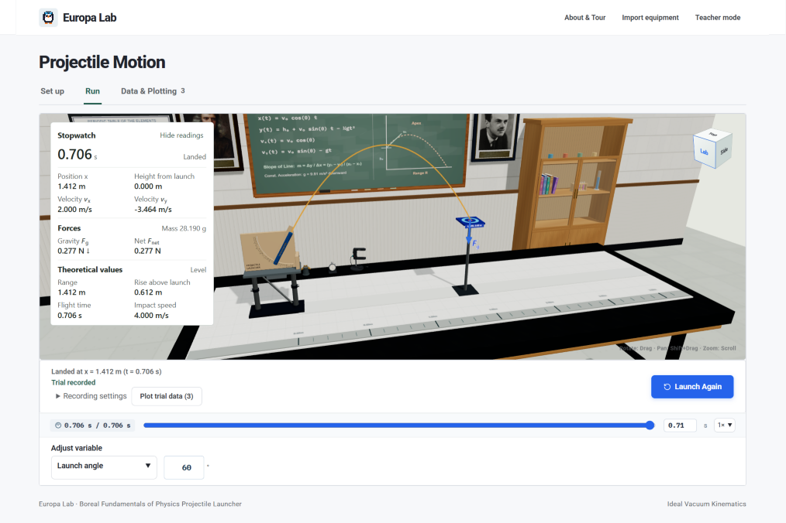
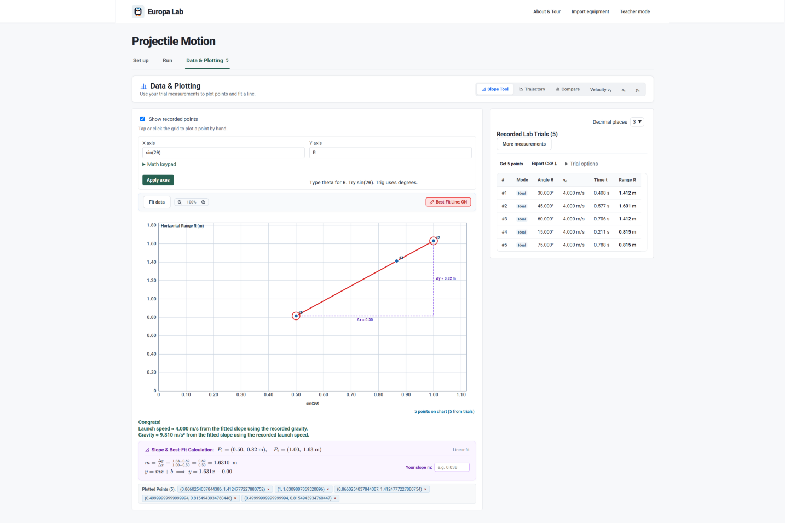

# Europa Lab

**A 3D projectile motion lab you can run in your browser.**

[Try the live lab](https://europalab.vercel.app/) · [Watch the demo](https://youtu.be/3OTV44FvVls)

Europa Lab brings the AP Physics lab workflow online. Pick a virtual launcher, change one variable, record a set of trials, and see what you can learn from the slope of a graph you design.



## Run an experiment

| Step | What you can do |
| --- | --- |
| **Set up** | Choose a launcher and adjust launch angle, initial speed, landing height, or gravity. Compare ideal motion with a model that includes air resistance and measurement variation. |
| **Run** | Launch a marble, inspect the trajectory in 3D, replay the trial, and record measurements such as range and flight time. |
| **Plot** | Write expressions for both axes, plot points by hand or show recorded points, fit a line, and export trial data as CSV. |

### Example · Estimate gravity from five trials

1. Choose **Same height** and **Ideal** mode. Keep initial speed at **4.00 m/s**.
2. Record trials at **15°, 30°, 45°, 60°, and 75°**.
3. In **Data & Plotting**, enter `sin(2θ)` for x and `R` for y. Fit a line to the data.
4. For equal launch and landing heights with no air resistance, the slope is **v₀²/g**. The fit below gives about **1.631 m**, so **g ≈ 16 / 1.631 ≈ 9.81 m/s²**.



## Teacher Mode and equipment import

**Teacher Mode** lets you start with a sample investigation or write your own. Set the trial count, choose what students can change, hide the quantity they’re solving for, and share the assignment with a link. Sample investigations include a reference equation for checking student graphs.

**Import equipment** can match supported product links or reference photos to existing launcher presets. The experimental Gemini-assisted importer can also draft an approximate model for unfamiliar equipment.

## Run locally

Use **Node.js 24 or newer**.

```sh
git clone https://github.com/linjeffrey21-creator/Europa-Lab-App.git
cd Europa-Lab-App
npm ci
npm run build
npm run serve
```

Open [http://127.0.0.1:4173/](http://127.0.0.1:4173/). For optional Gemini-assisted import, set `GEMINI_API_KEY` in a local `.env` file or in your deployment environment.

Built with **TypeScript**, **Three.js**, **Blender**, **Node.js**, and **Vercel**, with the **Gemini API** for assisted equipment import.
